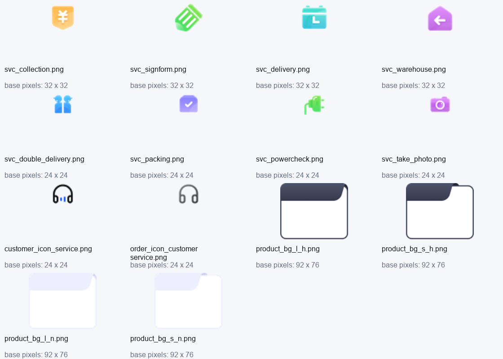

# 寄件生产 APK 实现取证：增值服务、原图、协议与浮窗

日期：2026-10-20。范围：按用户要求使用 reverse-engineer-anything 解包生产 App，解释上一轮 7 项反馈相关实现，并收窄交接中的未知。**本轮是静态取证和 RN 源码对照，未修改业务代码，未打包、安装、抓包或下单。**

随报告入库：[指定探针、原图摘要与协议历史证据](./evidence/2026-10-20-production-implementation.json)。完整 REA Evidence 和提取文件保留在文末所列本地目录。

后续状态：用户授权自主修改后，已落实原图、费用、浮窗、协议历史及三项服务的可确认部分，见 [代码落地记录](./2026-10-20-production-implementation-followup.md)。本文保留为修改前的静态取证记录；“尚未修复”描述对应取证时点。

## 1. 本轮结论

1. 生产端保留了增值服务的独立页面、控制器、费用汇总及服务费访问器名称。三项缺失服务已经找到具体字段候选，并能与同体系小程序的真实报价、下单代码交叉核对；不能再写成“完全找不到字段名”。**生产 App 的序列化函数体尚未恢复，因此值、请求层级、能力开关仍须保留验证边界。**
2. APK 内有 8 类服务的原始图标、4 张产品卡背景和客服耳机图。时效卡的书签带、折角、描边已经画在背景图中，后续视觉还原可以使用原图；图片固有尺寸不能直接等同于页面显示尺寸。
3. 协议正文与历史版本链接有包内结构化数据：`assets/jsons/protocol.json`。历史数组 12 行，`v1.8` 重复一次，去重为 11 个标题/链接对。无需只用“历史版本记录 >”总入口承接全部列表。
4. RN 源码存在两项可定位的问题：增值服务合计读取整票 `totalfee`；客服胶囊背景在拖动组件外，位移只作用于内部内容。二者均未在本轮修复或真机验收。

## 2. 身份、工具和证据口径

| 项目 | 本轮观察 |
| --- | --- |
| APK | `D:\rea-targets\dpapp-4.0.7.0.apk`，99,188,083 字节 |
| SHA-256 | `6c263175e4b6e985ca400f3c429e57f1196eff0698cdad2403edd436389cc12e` |
| JADX 声明 | `com.deppon.dpapp`，`4.0.7.0`，versionCode 609，minSdk 29，targetSdk 36 |
| arm64 `libapp.so` | 18,940,848 字节；SHA-256 `df41c829bcfbf14398a11e72bf519aa611b9f937599a74f8c89885e3b070a3ad` |
| snapshot hash | `78da37fed6bf1489361a312568249f3f`，VM/isolate 两处一致 |
| 字节扫描边界 | REA 定位的 isolate-data 文件区间 `[19264, 8038560)`；下文十六进制数均为 **libapp.so 文件偏移，非函数地址** |
| 引擎版本字面值 | `libflutter.so` 偏移 `0x1ebbff`：`3.11.5 (stable) (Wed Apr 15 00:36:32 2026 -0700) on "android_arm64"`；仅观察字面值，未独立核验 SDK 源码提交 |
| 解包范围 | Flutter assets、arm64 `libapp.so/libflutter.so`、二进制 manifest，共 1,373 个成员，逐文件比对 ZIP 内字节和 SHA-256 |

REA 的 `extract_artifact` 整包解压因 `res/9n.9.png` 与 `res/9N.9.png` 在 Windows 大小写不敏感文件系统冲突而失败。没有重复失败调用或改动 APK；随后用 Python ZIP API 仅提取无冲突的 Flutter 资源与 arm64 库。**这部分是自编脚本观察，不伪称 REA 解包成功。**完整 ZIP 库存仍由 REA 保留（2,244 个文件条目）。

证据分层：

- **REA**：包身份、完整文件库存、四个 snapshot 区间和摘要；其字符串投影有数量上限，覆盖为 partial。
- **ART**：本轮可复算的指定区间字节匹配、ZIP 成员、JSON 解析、PNG 尺寸和像素；证明内容存在，不等于恢复类/方法调用关系。
- **MP**：已知同体系 `D:\10531845\Desktop\CZH-DEV\mp-taro3` 源码的真实序列化逻辑；这是独立参照，不当作生产 App 源码。
- **RN**：当前仓库源码观察。
- **推断/未知**：明确标注，字符串相邻关系不作为调用边或字段归属证据。

## 3. 增值服务页面与费用组织

ART 观察到以下生产端源 URI 与符号名称：

| 线索 | 文件偏移 | 支持的范围 |
| --- | --- | --- |
| `package:dpapp/pages/service/express/view.dart` | `0x13969a` | 页面源路径存在 |
| `package:dpapp/pages/service/express/controller.dart` | `0x1d7aa3` | 页面控制器源路径存在 |
| `ServiceExpressControllerEx\|get#totalCost` | `0x145f29` | 控制器有对应名称的费用汇总访问器线索 |
| `ServiceExpressControllerEx\|get#addedFeeList` | `0x1499ce` | 增值费用列表访问器线索 |
| `ServiceExpressControllerEx\|get#doubleDeliveryVisible` | `0xdf8b2` | 双人派送含可见性判断线索，条件未知 |
| `ServiceExpressControllerEx\|get#powerMachineEnable` | `0xba6f3` | 验机含启用判断线索，条件未知 |
| `ServiceExpressControllerEx\|get#takePhotoEnable` | `0x12d242` | 拍照含启用判断线索，条件未知 |
| `PowerMachineSheet` / `PowerCategoryWidget` / `TakePhotoSheet` | `0xb57d0` / `0x1c3591` / `0x1761d4` | 子选择层/类别控件名称线索 |

还存在 `pages/service/express/widgets/{item,cost,bottom,power_check,take_photo,delivery_time,packing}.dart` 等源 URI。**由路径与访问器可推断页面按条目、费用、底栏、子选择层组织，尚不能声称已恢复它们之间的实际调用顺序。**上一轮生产端截图 `p10/p11/p15` 可独立佐证页面和服务费行的可见行为。

MP 参照实际闭环为：配置变化 → 防抖询价 → 匹配当前产品 → 从 `detail` 中按 `priceEntryCode` 取 `caculateFee` → 计算服务费合计。参考 `src/pages/sendService/service/index.tsx:683`、`:1094`、`:1134`、`:2342`，取费函数在 `src/utils/prodcuts.ts:418`。**这些时序和计算实现仅在 MP 源码中确认，尚未在 App 函数体确认。**

RN 的 `apps/com.deppon.app/src/pages/express/services/index.tsx:36` 明确不询价，`:122` 直接展示 `draft.selectedProduct.totalfee`，明细也复用整票报价；这与生产截图中的服务费合计仍有差距。独立页每次草稿变化即持久化（`:66`），而确认回传在 `:82`，返回/取消是否应保留草稿需另核生产行为。

## 4. 三项缺失服务：字段候选与真实 MP 映射

| 服务 | App AOT 命中（ART） | MP 报价字段与值 | MP 下单 `receive[0].orderExtendFields` | MP 服务费码 |
| --- | --- | --- | --- | --- |
| 双人派送 | `doubleDelivery` `0x1ca7ca` | `doubleDelivery: "Y"` | `{key:"doubleDelivery", value:"Y"}` | `SRPS` |
| 通电验机 | `powerMachineTypes` `0x1ca4f2`；`installationCategory` `0x142530`；`testMacHineQty` `0x1ba98c` | 阶段 `collect` / `delivery` / `collect,delivery`；类别名；件数默认 1 | 三个同名 key；件数转字符串 | `TDYJF` |
| 拍照签收 | `isPhotoSigning` `0x15a347`；`photoSigning` `0x1d9fe3` | **`isPhotoSigning: "Y"`** | **`{key:"photoSigning", value:"Y"}`** | `PZQS` |
| 揽收拍照 | `pickupPhoto` `0xde873` | `pickupPhoto: "LSPZ"` | `{key:"pickupPhoto", value:"LSPZ"}` | `LSPZ` |

4 个费项码在 App 同样有精确字节命中：`SRPS 0x1154ff`、`TDYJF 0x1510c8`、`PZQS 0x1e1ff4`、`LSPZ 0x152785`。生产包也存在 `ProductEntityEx` 的 `doubleDeliveryFee/powerMachineFee/signPhotoFee/pickupPhotoFee` 与控制器费用访问器名称。**码与字段的业务映射由 MP 源码确认，不能只凭 App 同时包含这两类字符串就宣称已确认 App 映射。**

MP 精确位置（以下均相对 `D:\10531845\Desktop\CZH-DEV\mp-taro3`）：

- 报价：`src/utils/send.ts:680` 验机；`:823` 两类拍照；`:831` 双人派送。
- 下单：`src/utils/send.ts:1586` 拍照；`:1601` 验机；`:1694` 双人派送；`:1882` 扩展字段加入收件项。
- 类型：`src/type/product.ts:150`、`:234`；费项枚举：`src/config/product.ts:328`、`:336`、`:344`、`:356`。
- 端点：`src/api/send.ts:15` 的 `queryPriceTime`、`:275` 的 `mysql/createOrder`。App 中对应完整路径分别命中 `0xfa01b`、`0x1d79ce`。

MP 旧字段分支的等价说明：

```ts
// 解释 MP 源码，不作为恢复出的 App 源码。
if (doubleDeliverySelected) {
  quote.doubleDelivery = 'Y'
  extend('doubleDelivery', 'Y')
}
if (signPhotoSelected) {
  quote.isPhotoSigning = 'Y'
  extend('photoSigning', 'Y')
}
if (pickupPhotoSelected) {
  quote.pickupPhoto = 'LSPZ'
  extend('pickupPhoto', 'LSPZ')
}
if (machineCategory) {
  const stages = [collectSelected && 'collect', deliverySelected && 'delivery'].filter(Boolean).join(',')
  quote.powerMachineTypes = stages
  quote.installationCategory = machineCategory
  quote.testMacHineQty = quantity || 1
  extend('powerMachineTypes', stages)
  extend('installationCategory', machineCategory)
  extend('testMacHineQty', String(quantity || 1))
}
```

MP 约束：验机类别由 `queryGoodsNameList`、`{standardLevelGoodsNames:"通电验机"}` 取得（`pages/sendService/service/index.tsx:1679`），件数 1–99，至少选收件/派送一个阶段；拍照两个阶段可同时选，至少一个（`components/Express/Powered/index.tsx:79`、`:112`；`Photo/index.tsx:76`、`:121`）。App 包中存在上述字段名、`queryGoodsNameList` 和对应中文文案，但 App 是否使用相同上下限和后台能力条件仍未恢复。

**重要分支边界**：MP 另有 `hotPotSwitch` 新模式，报价改发 `hotPotMenuPilot/waybillAvpList`（`utils/send.ts:795`），不能随意混发。App 指定 isolate-data 区间内 ASCII 搜索这三个 token，以及 `valueProductList/valProdCode/valProdName/optionContentMap` 均未命中。该有界负结果支持“旧字段分支更值得继续追踪”的推断，**不证明 App 全局不存在新模式，也不确证当前账号选中的请求分支**。

上一轮将包内 `5元/票` 与“验机按件计费”直接连在一起证据不足：`5元/票` 仅在 `0xb2174` 命中，未建立到服务项的引用关系。本轮不将其归给某一项；价格应读后端费项，不能硬编码。

## 5. 可直接对照的原始图片

原图目录：`D:\codeSpace\deppon-analysis\2026-10-20-send-reverse\extracted\assets\flutter_assets\assets\images`。8 个服务图标、产品卡背景、客服图均含基础版及 `2.0x/3.0x` 变体；SHA-256 与每个变体尺寸在本地 `visual-asset-manifest.json`。

| 对象 | 基础资源名 | 基础位图像素 |
| --- | --- | --- |
| 代收/签收单/派送/进仓 | `service_icon_collection.png`、`service_icon_signform.png`、`service_icon_delivery.png`、`service_icon_warehouse.png` | 32×32 |
| 双人/打包/验机/拍照 | `service_icon_double_delivery.png`、`service_icon_packing.png`、`service_icon_powercheck.png`、`service_icon_take_photo.png` | 24×24 |
| 深色耳机、蓝色细节 | `customer_icon_service.png` | 24×24 |
| 另一客服入口灰色耳机 | `order_icon_customer_service.png` | 24×24 |
| 产品卡深色背景 | `express_product_bg_l_h.png`、`express_product_bg_s_h.png` | 92×76 |
| 产品卡浅色背景 | `express_product_bg_l_n.png`、`express_product_bg_s_n.png` | 92×76 |

选中背景的渐变书签带、右上折角和外描边均是图内像素。`l/s/h/n` 是文件名观察；按图像可区分带宽与深浅，实际选图条件、缩放和布局参数仍未知。上一轮在 RN 手绘的近似颜色不是恢复出的生产端样式常量。



## 6. 协议：包内已有正文和 11 份历史链接

`assets/flutter_assets/assets/jsons/protocol.json` SHA-256：`5fe786b0b6dedc000ad956e60559ea5c42b9f5706ad2063b6340f0b6ee350869`。顶层有 `protocol`（121 个分段数组）和 `history`（12 行）两个 key。正文节点含 `type`、`text`，可按段落和强调类型组织；首段为“最近更新时间：2026年03月17日”。

| 历史日期 | 相对链接 |
| --- | --- |
| 2025-09-30 | `/depponmobile/protocol/service/v1.10` |
| 2025-07-15 | `/depponmobile/protocol/service/v1.9` |
| 2024-12-17 | `/depponmobile/protocol/service/v1.8`（原数组重复一次） |
| 2024-10-14 | `/depponmobile/protocol/service/v1.7` |
| 2024-07-30 | `/depponmobile/protocol/service/v1.6` |
| 2024-05-31 | `/depponmobile/protocol/service/v1.5` |
| 2024-03-05 | `/depponmobile/protocol/service/v1.4` |
| 2023-10-24 | `/depponmobile/protocol/service/v1.3` |
| 2023-09-02 | `/depponmobile/protocol/service/v1.2` |
| 2022-12-20 | `/depponmobile/protocol/service/v1.1` |
| 2022-07-05 | `/depponmobile/protocol/service/v1.0` |

包中还存在 `https://ca.deppon.com/ows/app/config/protocol.json`（`0x172971`）、`app_protocol_update` 和 `express_protocol_check` 名称。因此有远程配置/确认记录的线索，**未验证实际拉取时机、正文覆盖策略、缓存 key、确认版本失效规则**。包内 JSON 是可用静态基线，不能认定它始终等于当前服务端协议版本。本轮未请求这些业务 URL。

## 7. 客服拖动与蒙层：已经知道和仍未知的部分

ART 观察到 `package:dpapp/common/components/customer_service/draggable.dart`（`0x10edbe`）、`DraggableFloatWidget`（`0x16be8a`），配合上一轮生产截图/拖动证据，支持生产端有专用可拖动浮窗。**本轮未恢复其手势回调、上下边界、停靠算法。**

RN 的 `apps/com.deppon.app/src/shared/components/AppSupportFloat/index.tsx:24` 外层 View 持有白底与圆角，`:25` 内层才是 `AppNativeDraggable`；后者仅对自身 `Animated.View` 加 `translateY`（`src/shared/native/AppNativeDraggable.tsx:54`）。因此按源码结构，固定的白色壳与移动内容分离；需要将整块视觉与命中区域纳入位移，再做拖动真机复核。

ART 也观察到 Flutter `bottom_sheet.dart`、`showModalBottomSheet`，以及业务 coupon/payment 等弹层源 URI。**这不能证明对应页面具体调用哪个 API，也不能恢复蒙层是否动画、动画时长、导航栏覆盖和透明度。**此前 RN 260ms 和静态蒙层是实现选择；生产端开场 300ms 帧序列仍缺，不能把静态截图或全局 API 名称写成动画实证。

## 8. 7 项问题的本轮覆盖状态

| 条目 | 状态 | 本轮推进与剩余 |
| --- | --- | --- |
| R1 空地址 | 部分回答 | 延用既有生产截图量测；本轮未恢复渲染条件函数，RN 全新草稿截图仍待做 |
| R2 时效卡 | 部分回答 | 已拿到精确背景原图；生产选图条件/显示尺寸、RN 真机对照待做 |
| R3 蒙层动画 | 未解决动态证据 | 只有源 URI/API 名称；开场帧和实际动画函数仍未知 |
| R4 增值独立页 | 部分回答 | 页面/费用访问器、字段候选、MP 端到端参照已补；App 真实序列化与能力分支待验证 |
| R5 客服 | 部分回答 | 专用组件线索、原图、RN 拖动层级问题已定位；生产边界未知 |
| R6 协议 | 部分回答 | 正文/历史列表 JSON 已提取；生产确认记录与版本更新机制未知 |
| R7 费用明细 | 部分回答 | 费项名称/码与 MP 取费路径可参考；生产 App 明细函数体与无券 0 元行未确认 |

## 9. 可复用证据、限制与验证

本地证据根：`D:\codeSpace\deppon-analysis\2026-10-20-send-reverse`（二进制和完整 REA JSON 不入业务仓库）。

| 文件 | 用途 |
| --- | --- |
| `rea-evidence.json` | 完整 REA Evidence 导出；7 条记录，含 inventory、APK、AOT 原始记录及投影视图 |
| `extraction-manifest.json` / `apk-inventory.json` | 1,373 个提取成员 SHA-256 / ZIP 清单 |
| `probe_send_artifact.py` | 可复算 byte probe、1373 项逐字节/摘要验证、JSON 解析、图片联系图 |
| `service-string-evidence.json` | 59 个指定探针、编码、文件偏移、精确字节和局限 |
| `focused-source-uris.json` | 74 条目标相关 URI 字节观察，非完整类/函数清单 |
| `protocol-history.json` | 包内版本数组、重复项、正文首段及原文件摘要 |
| `visual-asset-manifest.json` | 14 组原图及密度变体、尺寸、摘要 |
| `engine-version-observations.json` | 引擎字面版本、偏移、库摘要 |

REA 主证据 ID：

- 文件库存：`ev_eb8e8a9467e4e0dd8101a516e7beb0da3f02e6f2abe18f2f809ea116a6fa9b36`。
- 包检查：`ev_03236d11c5e489cce06ffa6e1c63c0fedde26cdaf56ef878e724e79256220595`。
- Dart AOT：`ev_0f0e011c0028e22e38ad3829e5aff8b197204cf0adafa5862ecd34e3901de81c`。

当前 REA 连接正常、JADX 可用；native provider 的 Ghidra 未配置，且其当前 Windows 路由说明只覆盖受支持的 PE/raw 目标。没有取得 Dart 语义快照解析/带对象池符号的反汇编输出，**本轮不宣称已反编译出生产业务函数或完整源码**。后续若必须确证 App 函数体，需要匹配该 snapshot/SDK 的 Dart AOT 工具链或受支持主机；当前机器未找到 CMake/C++ 编译工具或可用 Linux 发行版，未安装工具链或修改 REA 配置。

已运行 `python D:\codeSpace\deppon-analysis\2026-10-20-send-reverse\probe_send_artifact.py`：1,373 个提取成员均与 ZIP 原文及记录摘要一致，59 个探针输出成功，JSON 12 行/11 个唯一历史链接，14 组图片验证并生成联系图。REA 证据已导出，active target 已关闭。文档与本轮新增小型证据另做一致性检查；本轮不重跑业务门禁，不把上一轮 338 pass 当作本轮执行结果。
